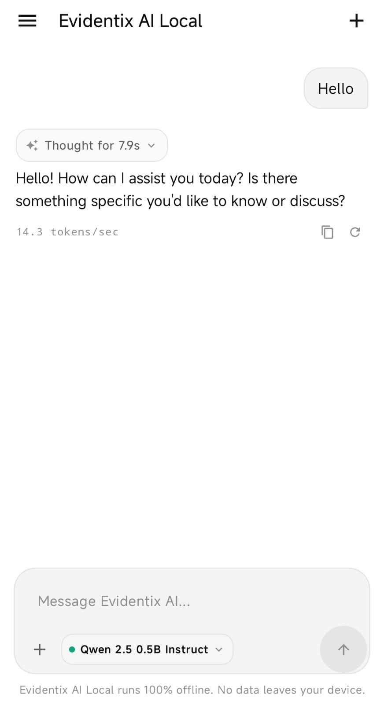
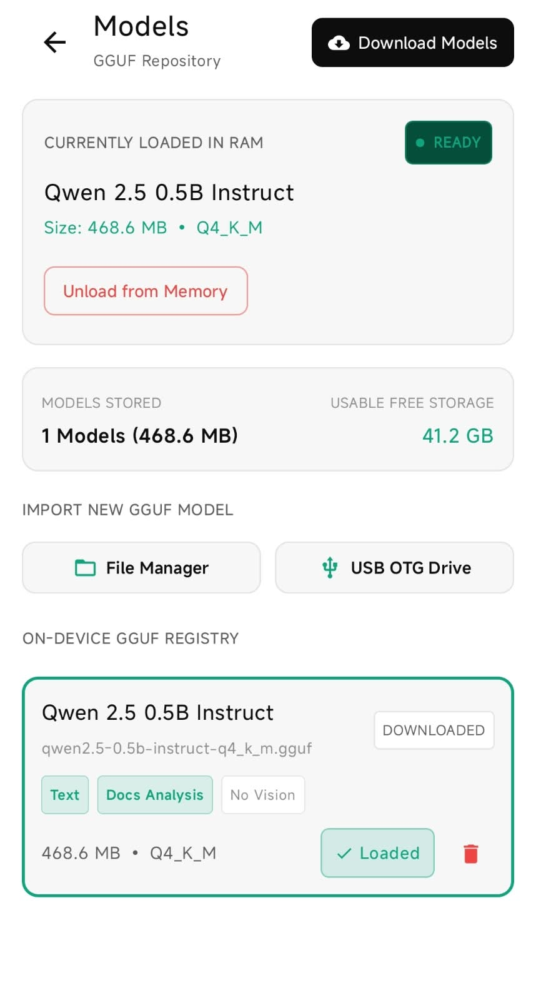
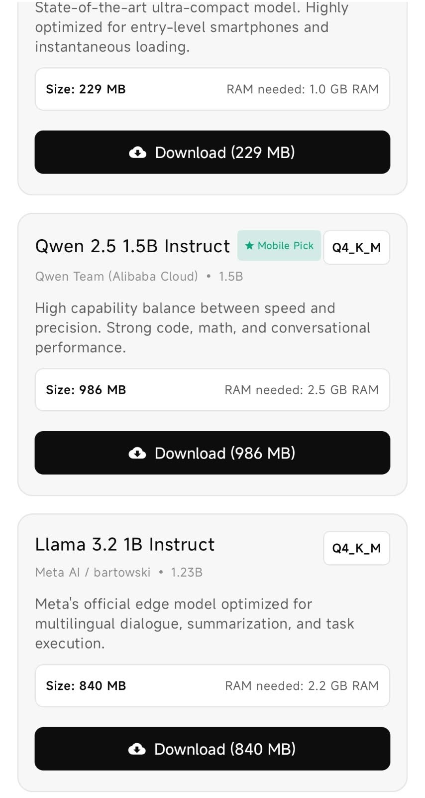

# Evidentix Local AI 📱🤖

  

  <b>Run Powerful AI Models 100% Offline Directly on Your Android Device.</b> 
  <i>Zero Cloud Dependency • Total Privacy • One-Click Install</i>

  

  
  
  
  

---

## 🚀 Overview

**Evidentix Local AI** brings the intelligence of Large Language Models (LLMs) directly into your pocket without requiring an internet connection. Powered by native high-performance mobile inference (`llama.cpp`), Evidentix allows you to run quantized GGUF models completely on-device.

Everything stays inside your phone's sandbox. No accounts, no subscriptions, no API keys, and no telemetry.

---

## ✨ Key Features

- ⚡ **Zero Setup & One-Click Install**  
  No developer mode, no termux, no command line. Just install the APK, select your preferred model, and start chatting immediately.

- 🔒 **100% Safe, Secure & Completely Offline**  
  Zero cloud inference. Your chats, prompts, and personal data never leave your phone. Works even in Airplane mode.

- 🧠 **Multiple Models Support**  
  Switch seamlessly between popular, state-of-the-art open models:
  - **Qwen 2.5 (0.5B, 1.5B, 3B)**
  - **SmolLM2 (360M)**
  - **Llama 3.2 (1B)**
  - Any custom `.gguf` model of your choice!

- 📥 **Built-in Model Download Center**  
  Download verified, high-efficiency quantized GGUF models directly within the app with single-tap downloads and real-time download progress.

- 💾 **External & Storage Import**  
  Import any custom GGUF model directly from your device storage, Downloads folder, or via USB OTG drive.

- 📊 **Real-time Hardware Telemetry**  
  Monitor active RAM usage, system memory thresholds, and token generation speed (tokens/sec) live during responses.

- 💬 **Local Chat History**  
  Securely save, manage, and continue conversations locally using an encrypted on-device database.

---

## 📸 Screenshots

  
  &nbsp;&nbsp;
  
  &nbsp;&nbsp;
  

  <i>1. Model Selection &nbsp;&nbsp;|&nbsp;&nbsp; 2. In-App Download Center &nbsp;&nbsp;|&nbsp;&nbsp; 3. Private Chatbox</i>

---

## 📥 How to Install

1. **Download the APK**:  
   Click the button below or grab `Evidentix-AI.apk` from this repository:  
   👉 [**Download Evidentix-AI.apk**](https://github.com/csibmohsin/Evidentix-Local-AI/raw/main/Evidentix-AI.apk)

2. **Allow Installation**:  
   Open the downloaded file. If prompted by Android, enable **"Install unknown apps"** for your browser or file manager.

3. **Launch & Choose Model**:  
   Open **Evidentix Local AI**, tap on the Download Center to download an optimized model (such as *Qwen 2.5 0.5B* or *SmolLM2* for instant speed), or select an existing `.gguf` model from your files.

4. **Start Chatting**:  
   You are now running on-device AI completely offline!

---

## 📱 Hardware Recommendations

| Model Size | Minimum RAM | Recommended RAM | Example Devices |
| :--- | :---: | :---: | :--- |
| **360M - 0.5B** | 3 GB | 4 GB | Entry-level & budget Android phones |
| **1B - 1.5B** | 4 GB | 6 GB | Mid-range smartphones |
| **3B** | 6 GB | 8 GB+ | Flagship & high-performance devices |

---

## 🛡️ Privacy & Security Commitment

- ❌ **No Internet Required for Chat**: The core AI engine runs entirely on your device's CPU/GPU.
- ❌ **No Data Transmission**: No prompts, chats, or personal information are ever uploaded.
- ❌ **No Accounts or API Keys**: Complete freedom and ownership of your AI assistant.

---

  Developed by <b>Mohsin Khawaja</b> | Cyber Solutions & Information Board (CSIB)

